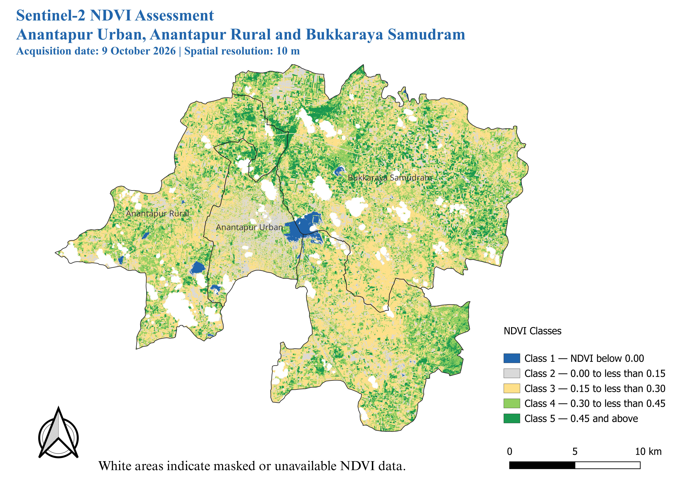

# Sentinel-2 NDVI Assessment of Three Mandals in Anantapur

**Version:** 1.0 — analysis complete; documentation and final validation in progress  
**Scene date:** 9 October 2026  
**Sensor/product:** Sentinel-2B MSI, Level-2A surface reflectance  
**Study area:** Anantapur Urban, Anantapur Rural, and Bukkaraya Samudram, Andhra Pradesh, India  
**Analysis CRS:** EPSG:32643 (WGS 84 / UTM zone 43N)  
**Primary pixel size:** 10 m (B04 and B08)

## Project overview

This project uses Sentinel-2 red and near-infrared reflectance to calculate the Normalized Difference Vegetation Index (NDVI), apply a cloud/shadow mask, clip the result to three mandal boundaries, classify NDVI into five descriptive ranges, and compare the resulting distributions between mandals.

The analysis is a **single-date spatial assessment**, not a time-series study. NDVI classes are numerical index ranges and should not be treated as verified land-cover labels, crop-health diagnoses, yield estimates, or measures of productivity.

## Final NDVI map



*Figure 1. Five-class NDVI map for the three-mandal study area from Sentinel-2B Level-2A imagery acquired on 9 October 2026. White regions indicate masked or unavailable NDVI data; they should not automatically be interpreted as clouds.*

## Study area and method

NDVI is calculated as:

\[
NDVI = \frac{B08 - B04}{B08 + B04}
\]

where B08 is Sentinel-2 near-infrared reflectance and B04 is red reflectance. Values are valid only where the denominator is non-zero and input pixels are valid. The analysis uses the following descriptive classes:

| Class | NDVI range |
|---|---|
| 1 | Below 0.00 |
| 2 | 0.00 to < 0.15 |
| 3 | 0.15 to < 0.30 |
| 4 | 0.30 to < 0.45 |
| 5 | 0.45 and above |

The SCL (Scene Classification Layer) is used in the cloud-masking workflow. Invalid pixels can include cloud/shadow-masked pixels and other NoData; the invalid-data percentage is **not automatically equivalent to cloud cover**.

## Main findings

| Measure | Result |
|---|---:|
| Mean NDVI across valid study-area pixels | 0.2786 |
| Median NDVI | 0.2634 |
| Standard deviation | 0.1259 |
| Valid-data coverage within the study boundary | 93.07% |
| Valid NDVI area | 505.889 km² |
| Largest class | 0.15 to < 0.30 |
| Largest class share of valid area | 47.59% |
| Area with NDVI ≥ 0.30 (Classes 4 and 5) | 194.442 km² (38.44%) |

### Mean NDVI by mandal

| Mandal | Mean NDVI | Median NDVI | Valid-data coverage |
|---|---:|---:|---:|
| Anantapur Urban | 0.2252 | 0.2122 | 92.40% |
| Anantapur Rural | 0.2779 | 0.2631 | 92.44% |
| Bukkaraya Samudram | 0.2913 | 0.2737 | 93.85% |

Bukkaraya Samudram has the highest mean NDVI in this scene; Anantapur Urban has the lowest. This difference describes the observed index values and does not, by itself, identify the causes. Independent land-cover information and additional dates would be needed for stronger causal or temporal conclusions.

## Work completed and final inference

The project workflow covered: (1) inspecting Sentinel-2 Level-2A inputs; (2) using B04 red and B08 near-infrared bands to calculate NDVI; (3) applying an SCL-based mask for selected cloud/shadow and unsuitable pixels; (4) preparing and combining the three mandal boundaries; (5) clipping NDVI to the study area; (6) checking raster values and valid-data coverage; (7) calculating overall and mandal-level statistics; (8) assigning five descriptive NDVI classes and estimating their areas; and (9) generating maps, charts, CSV summaries, and a QGIS layout.

### Main spatial interpretation

- The mean NDVI across valid study-area pixels was **0.2786** (median **0.2634**).
- The **0.15 to < 0.30** class was most common, covering **47.59%** of valid pixels (about **240.761 km²**).
- Classes with NDVI **≥ 0.30** accounted for **38.44%** of valid area (about **194.442 km²**).
- **Bukkaraya Samudram** had the highest mean NDVI (**0.2913**) and the largest Class 5 share (**13.41%**).
- **Anantapur Urban** had the lowest mean NDVI (**0.2252**) and the largest combined share of Classes 1 and 2 (**30.90%**).
- Valid NDVI coverage inside the study boundary was **93.07%**. The remaining **6.93%** is invalid or NoData and may include masked pixels and other data gaps; it is not a direct cloud-cover estimate.

The map shows a spatially heterogeneous pattern of NDVI across all three mandals, with areas in the moderate class (0.15 to < 0.30) widespread and patches of higher NDVI (≥ 0.30) interspersed across the study area. The urban mandal has lower summary NDVI than the two other mandals in this scene. Built-up surfaces and bare ground may contribute to that pattern, but this project did not independently classify land cover to test those causes. White gaps are masked or unavailable data, not a vegetation class.

**Scope of inference:** These are single-date observations for 9 October 2026. NDVI classes are descriptive spectral-index ranges; they do not prove land-cover type, crop health, yield, or productivity, and they cannot establish seasonal or long-term change. Multi-date imagery and independent land-cover/reference data would be needed to investigate those questions.

## Repository structure

```text
Project_01_Sentinel2_Vegetation/
├── src/             # Numbered Python processing and analysis scripts
├── data/
│   ├── raw/          # Original Sentinel-2 and source inputs (not included in this lightweight archive)
│   └── processed/   # Intermediate and final rasters/boundaries
├── reports/         # CSV statistics and exported figures
├── maps/            # Map exports, if present
├── notebooks/       # Learning and exploratory notebooks
├── docs/            # Research report and supporting notes
├── Anantapur_Sentinel2_V1.qgz
├── metadata.txt
├── requirements.txt
└── README.md
```

## Key outputs

- `reports/ndvi_statistics_by_mandal.csv`
- `reports/ndvi_mandal_comparison.csv`
- `reports/ndvi_class_area_statistics.csv`
- `reports/ndvi_class_distribution_by_mandal.csv`
- `reports/figure_1_mean_ndvi_by_mandal.png`
- `reports/figure_2_ndvi_class_distribution.png`
- `reports/figure_3_ndvi_classes_by_mandal.png`
- `reports/three_mandals_ndvi_map.png`
- `reports/three_mandals_ndvi_classification.png`
- `data/processed/Three_Mandals_NDVI_Classes_20261009.tif`
- `data/processed/Three_Mandals_Study_Area.geojson`

## Environment setup

Use Python 3.10 or newer where compatible with the installed geospatial package versions. From the project root:

```bash
python -m venv .venv
# Windows:
.venv\\Scripts\\activate
# macOS/Linux:
source .venv/bin/activate

python -m pip install --upgrade pip
python -m pip install -r requirements.txt
```

## Important reproducibility note

This lightweight archive intentionally excludes the large original Sentinel-2 `.SAFE` product and some intermediate NDVI rasters. As a result, **the full pipeline cannot be rerun from this archive alone**. The source TIFFs required by scripts 11 and 27–34 must be restored or regenerated from the original Sentinel-2 data before rerunning the full workflow. The final classified raster, statistics, maps, and boundary are retained for review. The QGIS project may open with its retained classification raster and boundary, but any missing data source in QGIS must be relinked.

Do not commit the original `.SAFE` folder or virtual environment to Git. Keep a separate local copy of the raw data and record the download/product identifier.

## Limitations

- Results represent one acquisition date (9 October 2026), so seasonal and long-term changes are not evaluated.
- NDVI is affected by atmosphere, illumination, soil background, vegetation stage, mixed pixels, and remaining cloud/shadow contamination.
- The five class ranges are descriptive thresholds, not a supervised land-cover classification.
- NoData includes masked/invalid pixels and must not be interpreted as cloud cover without a separate cloud assessment.
- Results depend on the study boundary version, masking rules, and raster alignment.

## Suggested citation

Project team. *Sentinel-2 NDVI Assessment of Anantapur Urban, Anantapur Rural, and Bukkaraya Samudram, Andhra Pradesh*. Version 1.0 draft; Sentinel-2B Level-2A scene acquired 9 October 2026.
